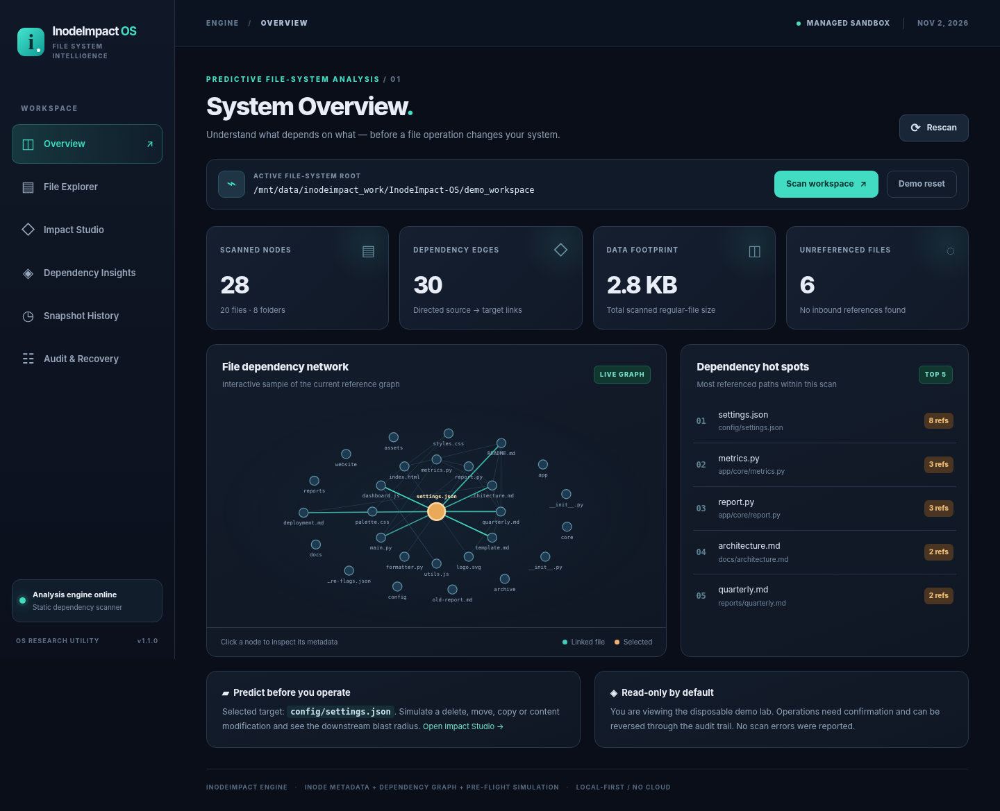
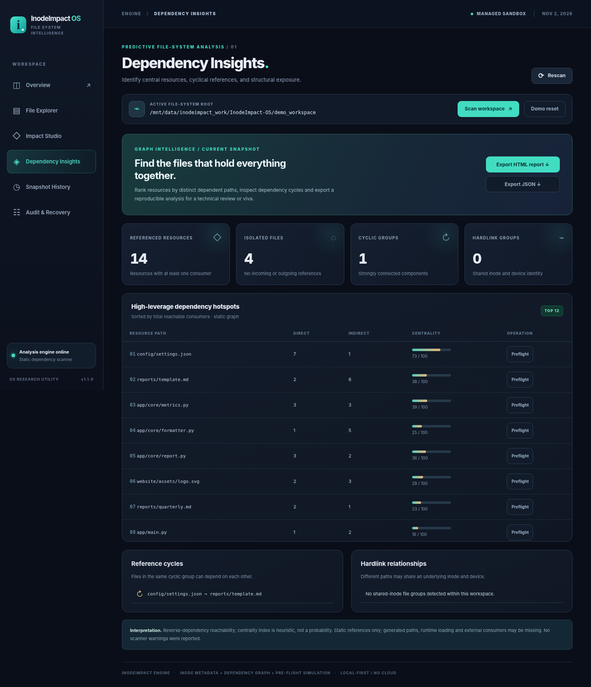
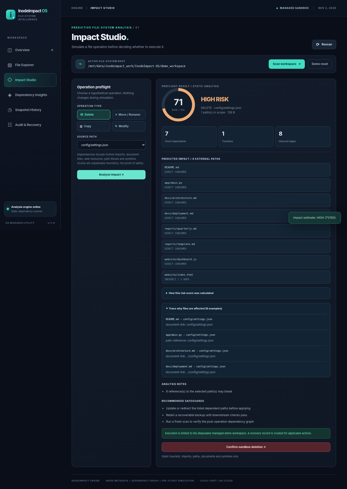

# InodeImpact OS

**Predictive File-System Dependency and Operation Impact Analysis System**

InodeImpact OS v1.1 is a local-first, OS-oriented analysis utility. It inspects a directory tree, reads real file-system/inode metadata, builds an evidence-backed dependency graph, and predicts the impact of hypothetical **delete, move, copy, and modify** operations before those operations occur.

> **Project classification:** an operating-systems utility and research prototype, **not** a new bootable operating system or kernel. It does not include scheduling or task management. Originality relative to every public or private repository cannot be guaranteed.

## What is included?

- Offline, dark-themed interactive browser dashboard (`http://127.0.0.1:8765`)
- Read-only recursive scanner using `os.scandir`, `lstat`-style metadata, size, inode, device ID, permissions, link count, SHA-256 and symlink targets
- Static reference extraction for Python imports, HTML/CSS/JS references, Markdown links, and common quoted file paths
- Directed dependency graph (`A → B` means **A depends on B**) with an SVG network and a searchable file inspector
- **Dependency Insights:** ranked resource hotspots, direct/transitive consumer counts, cyclic dependency groups, shared-inode hardlink detection and isolated files
- **Explainable impact tracing:** concrete shortest dependency paths with source evidence and a transparent score-factor breakdown
- **Portable reports:** download styled, print-ready HTML or inspectable JSON directly from the dashboard; optional CLI export
- Preflight risk estimator for **delete / move / copy / modify** with direct and transitive blast radius, reason evidence and recommendations
- Timestamped snapshots in SQLite; additions/deletions/modifications and dependency-edge deltas
- Built-in 20-file interconnected sample workspace
- **Sandbox-only** execution, undo backups, audit log and demo reset
- Command-line scanning and risk reports; 31 automated tests; cross-platform automated checks
- Zero third-party runtime dependencies; runs with Python 3.10+ on Windows, macOS, and Linux

## Dashboard preview



<details><summary>View advanced dashboard screens</summary>

**Dependency Insights**



**Explainable operation preflight**



</details>

## Quick start in Visual Studio Code

1. Install **Python 3.10 or newer** from https://www.python.org/downloads/ and **Visual Studio Code**.
2. Extract the provided ZIP file.
3. VS Code → **File → Open Folder** → select `InodeImpact-OS`.
4. VS Code → **Terminal → New Terminal**.
5. Run:

   ```bash
   python run.py
   ```

   On Windows, `py -3 run.py` also works. Or double-click `start_windows.bat`.

6. Open **http://127.0.0.1:8765** if your browser does not open automatically.
7. Open **Dependency Insights** to see the most influential files and export an HTML/JSON report.
8. Select **Impact Studio**, choose `config/settings.json`, choose **Delete**, and click **Analyze impact**. Expand **Trace why files are affected** and **How this risk score was calculated**.
9. Optional: click **Apply in sandbox** (requires confirmation). Go to **Audit & Recovery** to undo.

Stop the server by pressing **Ctrl+C** in the VS Code terminal. VS Code also includes **Run and Debug → InodeImpact OS — Dashboard** and a test task.

### No `pip install` needed

The backend and server use only standard Python modules. The browser assets are local files without npm or CDN dependencies.

### Upload the project through GitHub's website (no terminal Git commands)

Create an empty repository on GitHub, choose **Add file → Upload files**, then upload the **contents of the extracted `InodeImpact-OS` folder** (not just the ZIP file), and confirm the upload in the website. Files that start with a dot (such as `.github`, `.vscode`, and `.gitignore`) may be hidden in Windows Explorer; enable **View → Show → Hidden items** if necessary. The local `.runtime` folder is intentionally excluded from the distribution.

The website may limit the number or size of files per upload; screenshots are optional if necessary. Your actual application code belongs in the repository as individual files so it is viewable and searchable.

## Demo: test the impact predictor

Start with `config/settings.json` in the demo workspace. Several Python, web, Markdown, and reporting files refer to this file. A simulated deletion should identify multiple direct consumers plus a transitive consumer, producing a **HIGH** heuristic score. By contrast, the isolated file `archive/old-report.md` should have a much lower predicted impact.

Try a move with destination `archive/settings.json` and inspect why references to the original pathname are predicted to break. Try copying the same config file; existing references remain intact, so the score should be low.

## CLI examples

From the project folder:

```bash
# Run local web app
python run.py serve --port 8765

# Read-only scan of the demo folder and print JSON
python run.py scan

# Scan your own folder (does not modify it)
python run.py scan --root "C:\\Users\\YourName\\Documents\\MyProject"

# Estimate deletion of a central dependency
python run.py impact --operation delete --source config/settings.json

# Estimate a rename
python run.py impact --operation move --source app/core/metrics.py --destination app/core/metrics-v2.py

# Restore sample files (overwrites edits inside demo_workspace)
python run.py demo --reset

# Export a readable standalone technical report
python run.py report --format html --output report.html

# Export the same evidence as JSON
python run.py report --format json --output report.json

# Run test suite
python -m unittest discover -s tests -v
```

Linux/macOS example: `python3 run.py impact --operation delete --source config/settings.json`.

## Architecture

```text
                          Browser dashboard (HTML/CSS/JavaScript)
                                           │
                            loopback JSON API (server.py)
                                           │
              ┌────────────────────────────┼─────────────────────────┐
              │                            │                         │
       scanner.py                   analyzer.py                  storage.py
    metadata + evidence         reverse-graph BFS            SQLite history
              │                            │                         │
              └────────────────────────────┴─────────────────────────┘
                                           │
                              sandbox.py (demo ONLY)
                            apply / recovery / audit
```

The server binds to `127.0.0.1`, not a publicly accessible network interface. No telemetry, hosting, API keys, accounts, or external HTTP services are needed.

### Scanner

For each accessible path, the scanner records `st_ino`, `st_dev`, `st_nlink`, `st_mode`, `st_size`, `st_mtime` and, for small files, SHA-256. It reads known text file types up to 768 KiB for dependency extraction. It intentionally **does not follow directory symlinks**. It skips common generated/build directories such as `.git`, `.venv`, `node_modules`, and `__pycache__`. The default maximum is **4,000 nodes**.

For Windows, inode information depends on the filesystem and Python's implementation; device and inode values may not have identical semantics to Linux ext4 inode IDs.

### Dependency intelligence and report generation

`inodeimpact/insights.py` computes distinct direct and transitive consumers, heuristic centrality, strongly connected cycles, and observed inode-sharing relationships. The centrality index helps prioritize attention; it is **not** a statistical probability. `inodeimpact/reporting.py` creates a self-contained HTML technical report and a machine-readable JSON version. Reports include scanner provenance, ranked hotspots, representative deletion preflights, warnings and interpretation limits.

For explainability, each operation preflight includes the contributing score factors and up to 40 shortest known paths from affected consumers to the selected resource. Every trace step preserves the scanner's evidence type and reference token.

### Impact propagation

Edges point from a consumer to a resource (`consumer → resource`). Starting at the operation target (or all descendants of a selected folder), a reverse adjacency traversal identifies direct dependents and their transitive upstream consumers.

```text
website/index.html ──→ website/dashboard.js ──→ config/settings.json
app/main.py ───────────────────────────────────→ config/settings.json
reports/quarterly.md ─────────────────────────→ config/settings.json
```

If `config/settings.json` disappears, all direct consumers may break, and `website/index.html` can also be indirectly affected through `website/dashboard.js`.

The risk number **0–100 is a heuristic**, not a learned failure probability. It considers the operation type, number of direct and indirect dependents, additional inbound references, moved files' outgoing references and subtree breadth. Static analysis cannot guarantee that an operation is safe; runtime-generated paths, compiled code, external programs, processes and environment-dependent modules are out of scope.

See [ARCHITECTURE.md](ARCHITECTURE.md) for algorithm details, data flow, complexity and caveats.

## Workspace safety and recovery

| Action | Any folder you scan | Managed `demo_workspace` |
|---|---|---|
| Inspect paths and metadata | Yes, read-only | Yes |
| Simulate delete/move/copy/modify | Yes | Yes |
| Apply an operation from dashboard | **No** | **Yes, with confirmation** |
| Undo an applied operation | Not applicable | Yes, where its state still permits |
| Reset bundled demo | Doesn't touch your folder | Recreates 20 sample files |

Mutation requests are denied for externally scanned roots even if submitted directly via the JSON API. Source/destination validation rejects absolute paths, traversal, symlink paths, and an existing target. Cross-origin POST requests and unsupported POST content types are also rejected to reduce browser-driven localhost request forgery. The sandbox stores recoverable copies under `.runtime/backups` and an audit ledger in `.runtime/impact.sqlite3` (ignored by Git).

**Important:** Demo reset intentionally discards edits under `demo_workspace`. Avoid putting personal data there. Sandbox copy/modify undo checks a content fingerprint and refuses to erase subsequent edits. It is still not a transactional filesystem. Treat the undo flow as a teaching aid, not an atomic transaction system.

## API overview

| Route | Method | Purpose |
|---|---|---|
| `/api/health` | GET | Version and health status |
| `/api/overview` | GET | Current graph, metadata, summary |
| `/api/insights` | GET | Ranked hotspots, cycles, isolated files and hardlinks |
| `/api/report?format=html` | GET | Download standalone, print-ready analysis report |
| `/api/report?format=json` | GET | Download machine-readable analysis report |
| `/api/scan` | POST | Scan optional `{ "root": "..." }` folder |
| `/api/simulate` | POST | `{ "operation": "delete", "source": "config/settings.json" }` |
| `/api/view?path=...` | GET | Safe small text file preview |
| `/api/history` | GET | Saved snapshots for active root |
| `/api/diff` | GET | Compare recent scans, or explicit `old`/`new` IDs |
| `/api/audit` | GET | Recent sandbox operation log |
| `/api/apply` | POST | Sandbox only; requires `confirm: true` |
| `/api/undo` | POST | Sandbox only; requires `audit_id` and `confirm: true` |
| `/api/demo/reset` | POST | Explicit reset with `confirm: true` |

## Project tree

```text
InodeImpact-OS/
├── run.py                      Main entry point + CLI
├── inodeimpact/
│   ├── models.py               Node / Edge / Snapshot data model
│   ├── scanner.py              File system walk + dependency evidence
│   ├── analyzer.py             Prediction + evidence paths + risk factors
│   ├── insights.py             Hotspots, graph cycles, hardlink groups
│   ├── reporting.py            Portable HTML/JSON technical reports
│   ├── storage.py              SQLite snapshots and audit log
│   ├── sandbox.py              Demo seed, execution and undo
│   └── server.py               Loopback HTTP/JSON service
├── static/
│   ├── index.html              Dashboard shell
│   ├── styles.css              Responsive interface
│   └── app.js                  Browser interactions and SVG network
├── demo_workspace/            20 interconnected real files
├── tests/                     31 automated unit and API integration tests
├── docs/                      Demo walkthrough, specifications, UI screenshots
├── CHANGELOG.md               Release notes
├── .vscode/                   Run/debug and testing tasks
├── .github/workflows/ci.yml  Example automated CI pipeline
├── ARCHITECTURE.md            Technical report
├── SECURITY.md                Safety model
└── start_windows.bat          Windows launcher
```

## Suggested presentation / viva flow (4–5 minutes)

1. Explain the problem: a delete or rename looks local but a consumer graph makes its downstream consequences non-local.
2. Show real file metadata (inode/device/link count) and clarify cross-platform differences.
3. Explain directed references and the reverse-graph traversal algorithm.
4. Show Dependency Insights and trace a two-hop consumer chain to the selected config file.
5. Simulate deleting a central config and compare it against an isolated archived file.
6. Export a technical report, demonstrate safe sandbox apply/undo, and state the limitations plainly.

For a step-by-step demonstration with expected results, see [docs/DEMO_WALKTHROUGH.md](docs/DEMO_WALKTHROUGH.md). For a technical review, see [docs/SYSTEM_SPECIFICATION.md](docs/SYSTEM_SPECIFICATION.md).

## Future extensions

- Kernel-level event collection via inotify, FSEvents, or Windows ReadDirectoryChangesW
- Language-specific AST/resolver plugins for deeper JavaScript/TypeScript, C/C++ and build-file analysis
- Atomic journaled transactions with crash-safe recovery and checksums
- Predictive scores calibrated to controlled failure-injection data
- Git-aware branch and build-system dependency impact analysis

## License

MIT, see [LICENSE](LICENSE).
